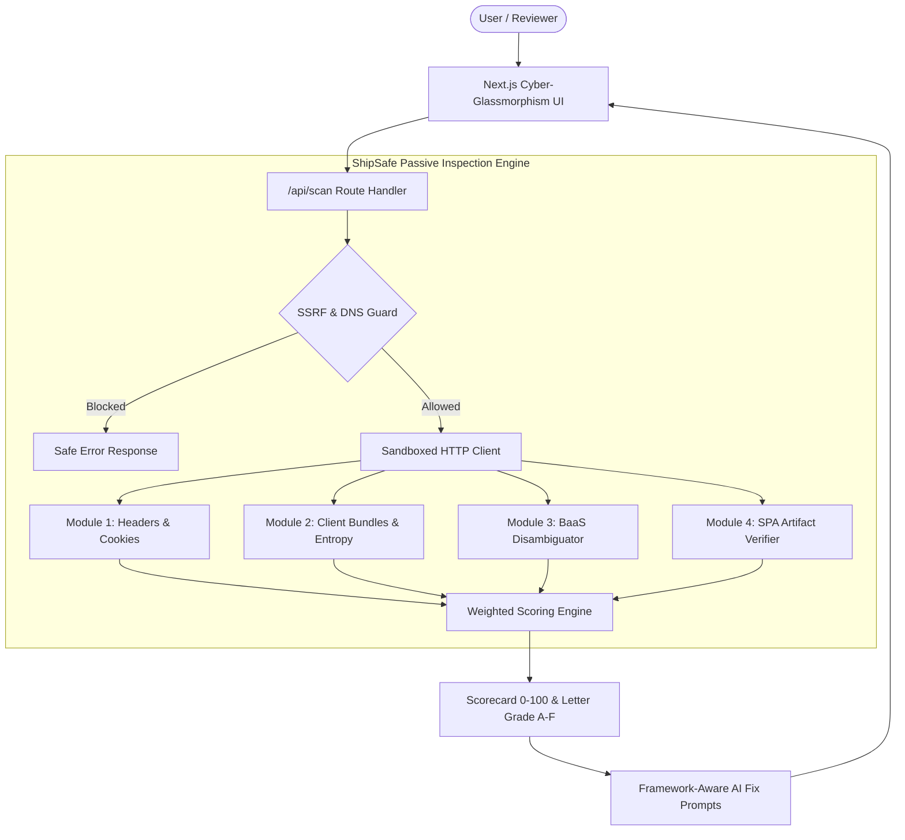

# 🛡️ ShipSafe — Passive Security Hygiene Auditor

> **The 10-Second Security Sanity Check for Startups & AI-Built Web Apps.**  
> Detects leaked admin keys, exposed source maps, and missing HTTP headers with automated letter grading (A–F) and framework-aware, copy-paste AI remediation prompts.

[](https://nextjs.org/)
[](https://www.typescriptlang.org/)
[](https://tailwindcss.com/)
[-orange?style=for-the-badge)](https://owasp.org/)
[]()

---

## 1. Problem & Context: The "Vibe-Coding" Security Gap

AI-assisted coding assistants (Cursor, v0, Bolt.new, Lovable, Replit Agent) allow developers to ship full-stack web applications in hours. However, rapid generative shipping introduces predictable, dangerous security hygiene mistakes:
1. **Accidental BaaS Admin Key Leaks:** When permissions fail, AI assistants frequently advise using the `SUPABASE_SERVICE_ROLE_KEY`. Developers often copy this directly into client environment variables (`NEXT_PUBLIC_`), inadvertently granting anyone full read/write database bypass access.
2. **Exposed Production Source Maps (`.js.map`):** Bundlers often deploy unminified source maps to production, allowing competitors and malicious actors to inspect the complete original React/TypeScript codebase, internal comments, and hidden routes.
3. **Accidental Static `.env` Exposure:** Deployment scripts sometimes copy `.env` files into public static folders.
4. **Missing Defense-in-Depth Headers:** Missing Content-Security-Policy (CSP), HSTS, and frame protections leave users vulnerable to XSS and clickjacking.

Traditional enterprise scanners are either too noisy (dumping 200 cryptic CVE warnings) or active/invasive (running illegal attacks). **ShipSafe** provides a **strictly passive, non-invasive, 10-second sanity check** with copy-paste remediation prompts developers can paste straight back into their code editor.

---

## 2. High-Level Architecture & Flow



---

## 3. Four Core Engineering Decisions (Interview Highlights)

### 1. Bulletproof SSRF & Anti-DNS-Rebinding Architecture (CWE-918)
* **The Vulnerability:** Naive scanners that accept arbitrary URLs act as open proxies for attackers to scan internal infrastructure (`http://169.254.169.254` AWS metadata, `http://localhost:5432`, or private subnets). Attackers can also use DNS rebinding (domains with 0-second TTLs that resolve to a public IP on first check, but resolve to `127.0.0.1` upon socket connection).
* **Our Defense:** ShipSafe implements an RFC-compliant network filter (RFC 6890, RFC 1918, RFC 3927, RFC 4291). Hostnames are resolved to all IP records, and connections are blocked if *any* record belongs to private/link-local/multicast/broadcast or IPv4-mapped IPv6 spaces. Crucially, ShipSafe intercepts redirects manually and **re-evaluates the SSRF guard on every single redirect hop**.

### 2. Shannon Entropy ($H \ge 3.6$) + Character Set Filtering
* **The Vulnerability:** Running complex regular expressions over minified 500,000-character single-line JS bundles can cause catastrophic backtracking (ReDoS) or lock up the Node.js event loop.
* **Our Defense:** ShipSafe extracts candidate string literals first, and calculates **Shannon Information Entropy**:
  $$H(X) = -\sum_{i=1}^{n} P(x_i) \log_2 P(x_i)$$
  Strings failing the $H \ge 3.6$ threshold or lacking mixed alphanumeric cryptographic character diversity (e.g. natural language identifiers like `handleSubmitOnClickWithParams`) are dismissed *before* regex evaluation.

### 3. The BaaS Disambiguation Engine (Zero False Positives)
* **The Vulnerability:** Supabase and Firebase rely on public client configuration keys (`anon` key, `apiKey`). Amateur security tools flag every JWT as a critical leak, destroying developer trust.
* **Our Defense:** ShipSafe base64-url decodes the JWT payload in memory without requiring signature secrets:
  * If `payload.role === "service_role"`: Categorized as **CRITICAL (-40 pts)** with an emergency rotation prompt.
  * If `payload.role === "anon"`: Categorized as **SAFE / INFO (0 pts)** and surfaces an educational Row-Level Security (RLS) checklist.

### 4. SPA Catch-All False-Positive Eliminator
* **The Vulnerability:** Modern Single-Page Applications (Next.js, Vite, React Router) intercept missing routes like `/.env` or `/.git/config` and return `HTTP 200 OK` with `index.html`. Naive status-code checks create false alarms.
* **Our Defense:** Structural signature validation. An artifact is only flagged if `Content-Type` is not `text/html` and the payload matches true file signatures (e.g. at least 2 distinct `KEY=VALUE` environment variables for `.env`, or `[core]` and `repositoryformatversion` for `.git/config`).

---

## 4. Evaluated Standards & Audit Matrix

| Category | Standard Mapping | Checks Performed |
| :--- | :--- | :--- |
| **BaaS & Secrets** | OWASP A02:2021 (Cryptographic Failures)<br>OWASP A01:2021 (Broken Access Control) | Supabase `service_role` vs `anon` JWTs, OpenAI Project (`sk-proj-`) & legacy keys, Stripe (`sk_live_`, `rk_live_`, `whsec_`) vs publishable (`pk_live_`), Anthropic (`sk-ant-`), AWS Access Keys (`AKIA...`), GitHub PATs (`ghp_`), Slack Webhooks. |
| **Security Headers** | OWASP A05:2021 (Security Misconfiguration)<br>OWASP ASVS V14 (Configuration) | Content-Security-Policy (CSP) presence and weak `'unsafe-inline'` detection; HSTS (`max-age >= 31536000`); X-Frame-Options (DENY/SAMEORIGIN); X-Content-Type-Options (`nosniff`); Referrer-Policy (`strict-origin-when-cross-origin`). |
| **Information Disclosure** | OWASP A05:2021 (Security Misconfiguration) | `X-Powered-By` technology headers, verbose `Server` version banners. |
| **Cookie Hygiene** | OWASP ASVS V3.4 (Cookie Architecture) | `HttpOnly` on session/auth cookies; `Secure` on HTTPS; `SameSite` flags. |
| **CORS Hygiene** | OWASP A01:2021 (Broken Access Control) | Permissive `Access-Control-Allow-Origin: *` paired with `Access-Control-Allow-Credentials: true`. |
| **Build Artifacts** | OWASP A05:2021 (Security Misconfiguration) | Signature-verified `/.env`, `/.git/config`, `swagger.json`, and `.js.map` production source maps. |

---

## 5. Defensive Unit Test Suite (83 Automated Assertions)

The project includes an extensive test suite verifying both positive catches and false-positive rejections:

```bash
# Run SSRF & Anti-DNS Rebinding Tests (25 tests)
npx tsx tests/ssrf.test.ts

# Run Shannon Entropy & Token Extraction Tests (13 tests)
npx tsx tests/entropy.test.ts

# Run BaaS & Secret Rules Tests (12 tests)
npx tsx tests/secrets.test.ts

# Run HTTP Headers & Cookie Hygiene Tests (14 tests)
npx tsx tests/headers.test.ts

# Run SPA Artifact Signature Tests (8 tests)
npx tsx tests/artifacts.test.ts

# Run Scoring & Markdown Exporter Tests (11 tests)
npx tsx tests/scoring.test.ts
```

---

## 6. Self-Hardening Guarantee (Eating Our Own Dog Food)

ShipSafe is hardened against its own inspection engine. In `next.config.mjs`, ShipSafe enforces:
* Strict Content-Security-Policy (CSP)
* Strict-Transport-Security (HSTS 2-year duration with preload)
* X-Frame-Options: DENY
* X-Content-Type-Options: nosniff
* Referrer-Policy: strict-origin-when-cross-origin
* Suppressed `X-Powered-By` header
* Disabled production source maps

**Auditing ShipSafe with ShipSafe produces a 100/100 (Grade A+).**

---

## 7. Getting Started Locally

```bash
# 1. Clone repository
git clone https://github.com/Hemanth7513/ShipSafe.git
cd shipsafe

# 2. Install dependencies
npm install

# 3. Run development server
npm run dev

# 4. Open in browser
# Navigate to http://localhost:3000
```

---

## 8. License & Ethical Disclaimer

ShipSafe is distributed under the **MIT License**. It performs strictly read-only, passive inspections of publicly served HTTP responses and linked client-side scripts. It does not perform active exploitation, fuzzing, or database record exfiltration. Users must confirm domain authorization prior to conducting an audit.
